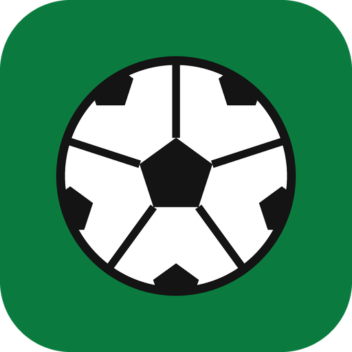

# Próximo Jogo — agenda do seu clube no Home Assistant

[](https://hacs.xyz/)

Integração para o Home Assistant que mostra o **próximo jogo do seu clube** das Séries A e B do Brasileirão: adversário, data e hora, estádio, campeonato, rodada e onde assistir. Os dados vêm do [ge.globo](https://ge.globo.com/), e a integração já vem com um **card pronto** para o painel.

<p align="center"></p>

## O que ela faz

- **Escolha em dois passos:** primeiro a série (A ou B), depois o clube. A lista sai da classificação atual do ge, então acompanha quem sobe e quem cai.
- **Todos os campeonatos:** Brasileirão, Copa do Brasil, Libertadores, Sul-Americana e estaduais, quando o ge publica a agenda do clube.
- **Card incluído:** é instalado junto com a integração. Basta adicionar o card **Próximo Jogo** ao painel.
- **Calendário:** os jogos aparecem no calendário do Home Assistant e servem de gatilho para automações (por exemplo, "1 hora antes do jogo").
- **Placar ao vivo:** perto do jogo e durante ele, a atualização passa de 1 hora para 5 minutos e o card mostra o placar.
- **Mais de um clube:** adicione a integração de novo para cada clube.

## Instalação

### Pelo Marketplace (Home Assistant 2026.11 ou mais novo)

1. Vá em **Configurações > Marketplace** e clique em **Adicionar a partir do link**. Na primeira vez, ele pede para conectar a sua conta do GitHub.
2. Cole `https://github.com/dougbaptista/ha_proximo_jogo` e clique em **Adicionar**.
3. Abra **Próximo Jogo** na seção **Novo** e clique em **Instalar**. Não precisa reiniciar: a configuração abre em seguida.

### Pelo HACS (versões anteriores)

1. No HACS, abra o menu de três pontos, depois **Repositórios personalizados**.
2. Adicione `https://github.com/dougbaptista/ha_proximo_jogo` com o tipo **Integração**.
3. Procure **Próximo Jogo** no HACS e instale.
4. Reinicie o Home Assistant.
5. Vá em **Configurações > Dispositivos e serviços > Adicionar integração** e procure **Próximo Jogo**.

[](https://my.home-assistant.io/redirect/hacs_repository/?owner=dougbaptista&repository=ha_proximo_jogo&category=integration)

Requer Home Assistant **2024.11** ou mais novo. Não instala dependências Python.

## Entidades criadas

Cada clube vira um dispositivo com:

| Entidade | Exemplo | Observação |
|---|---|---|
| `sensor.<clube>_proximo_jogo` | `2026-11-04T22:30:00+00:00` | Data e hora do jogo. Os atributos trazem o jogo completo (é o que o card lê). |
| `sensor.<clube>_adversario` | `Flamengo` | |
| `sensor.<clube>_campeonato` | `Campeonato Brasileiro` | |
| `sensor.<clube>_estadio` | `Maracanã` | |
| `sensor.<clube>_mando` | `fora` | `casa` ou `fora`. |
| `sensor.<clube>_onde_assistir` | `Premiere, Cartola` | |
| `calendar.<clube>_jogos` | | Fica ligado durante a partida. |

Atributos do sensor principal: `mandante`, `visitante`, `sigla_mandante`, `sigla_visitante`, `escudo_mandante`, `escudo_visitante`, `adversario`, `mando`, `campeonato`, `fase`, `rodada`, `estadio`, `transmissao`, `link`, `situacao` (`futuro`, `ao_vivo` ou `sem_jogo`), `hora_definida`, `placar_mandante`, `placar_visitante`, `fonte` e `ultima_atualizacao`.

## O card

Depois de instalar, edite o painel, clique em **Adicionar card** e procure **Próximo Jogo**. O card já vem configurado com o sensor do clube. Em YAML:

```yaml
type: custom:proximo-jogo-card
entity: sensor.gremio_proximo_jogo
mostrar_campeonato: true    # campeonato e rodada no topo
mostrar_transmissao: true   # "onde assistir" embaixo
mostrar_nome: false         # nome do time em vez da sigla
```

Ao clicar no card, abre a página da partida no ge.

> Se o card não aparecer logo depois de instalar, recarregue a página do navegador (Ctrl+F5). O arquivo do card é servido pela própria integração, sem cadastro em **Painéis > Recursos**.

## Aviso do jogo (blueprint pronto)

Avisa antes do jogo (notificação do Home Assistant, celular, Telegram...), repete o aviso de tempos em tempos até a bola rolar e, quando o jogo começa, acende a luz na cor do time se tiver alguém em casa. Importe com um clique e preencha os campos:

[](https://my.home-assistant.io/redirect/blueprint_import/?blueprint_url=https%3A%2F%2Fgithub.com%2Fdougbaptista%2Fha_proximo_jogo%2Fblob%2Fmain%2Fblueprints%2Fautomation%2Fproximo_jogo%2Faviso_do_jogo.yaml)

| Campo | Padrão | O que faz |
|---|---|---|
| Time | | O sensor "Próximo jogo" do time. |
| Começar a avisar quanto tempo antes | 120 min | Primeiro aviso. |
| Repetir o aviso a cada | 30 min | Use 0 para avisar uma vez só. |
| Como avisar | notificação do Home Assistant | Troque pelo celular (`notify.mobile_app_...`), Telegram, WhatsApp ou Alexa usando `{{ titulo }}` e `{{ mensagem }}`. |
| Quem conta como "tem alguém em casa" | `zone.home` | Zona, pessoa, grupo ou sensor de presença. |
| Luzes e cor do time | | Acendem quando o jogo começa, se tiver alguém em casa. |

## Exemplo de automação com o calendário

Avisar 1 hora antes do jogo, usando o calendário:

```yaml
automation:
  - alias: "Aviso: jogo em 1 hora"
    triggers:
      - trigger: calendar
        event: start
        entity_id: calendar.gremio_jogos
        offset: "-1:00:00"
    actions:
      - action: notify.notify
        data:
          message: >
            {{ trigger.calendar_event.summary }} começa em 1 hora
            ({{ trigger.calendar_event.location or 'local a definir' }}).
```

## De onde vêm os dados

O ge não tem API pública: a integração lê o JSON que vem embutido nas páginas, nesta ordem:

1. **Agenda do clube** (`.../agenda-de-jogos-do-<clube>/`): a mais completa, com estádio, rodada e onde assistir.
2. **Página do clube** (`.../futebol/times/<clube>/`): próximos jogos. O estádio sai da página da partida.
3. **Página do campeonato**: só a rodada atual do Brasileirão. É usada pelos clubes que não têm agenda no ge.

Se uma busca falhar, o último jogo conhecido continua no card. Se o ge mudar o layout das páginas, a integração para de atualizar até sair uma nova versão. Abra uma [issue](https://github.com/dougbaptista/ha_proximo_jogo/issues) se isso acontecer.

Este projeto não tem ligação com o Grupo Globo.

## Desenvolvimento

- Python 3.12, com `black`, `isort` e `flake8` (pre-commit) e testes com `pytest` (`pip install -r requirements-dev.txt && pytest`).
- O `parser.py` não importa o Home Assistant e é testado com recortes reais das páginas do ge em `tests/fixtures/`.
- A tabela de clubes (`clubes.py`) é gerada por `python scripts/gerar_clubes.py`. Rode o script a cada temporada, quando mudam os clubes das Séries A e B.

## Vídeos e canal

Tutoriais de Home Assistant em português no canal [Doug Smart Home](https://www.youtube.com/@dougsmarthome) e em [dougsmarthome.com.br](https://dougsmarthome.com.br).
